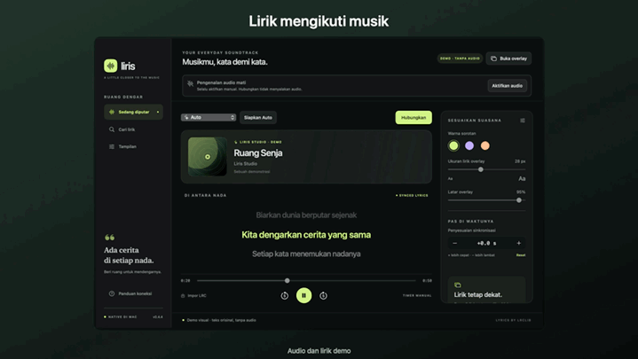

<p align="center">
  
</p>

<h1 align="center">Liris</h1>

<p align="center">Lirik yang mengikuti musikmu di macOS dan Windows, langsung di aplikasi atau lewat overlay.</p>

<p align="center">
  <a href="#unduh">Unduh</a> ·
  <a href="#mulai-pakai">Mulai pakai</a> ·
  <a href="#fitur">Fitur</a> ·
  <a href="#dokumentasi">Dokumentasi</a>
</p>

<p align="center">
  
</p>

## Unduh

| Platform | Paket | Catatan rilis |
| --- | --- | --- |
| macOS 14+ · Apple Silicon | [Unduh ZIP untuk Mac](https://github.com/Fikriazrbni/Liris/releases/download/v0.4.4/Liris-v0.4.4-macos-arm64.zip) | [v0.4.4](https://github.com/Fikriazrbni/Liris/releases/tag/v0.4.4) |
| Windows 11 · x64 | [Unduh installer Windows](https://github.com/Fikriazrbni/Liris/releases/download/windows-v0.1.0/Liris-Setup-Windows-x64.exe) | [Preview v0.1.0](https://github.com/Fikriazrbni/Liris/releases/tag/windows-v0.1.0) |

Python dan ShazamIO sudah disertakan di kedua paket. Build Mac belum dinotariskan oleh Apple dan installer Windows belum ditandatangani.

### Homebrew untuk Mac

```sh
brew install --cask fikriazrbni/tap/liris
```

Jika Liris sudah terpasang lewat Homebrew, jalankan perintah berikut untuk memperbaruinya. [Tap Homebrew](https://github.com/Fikriazrbni/homebrew-tap)

```sh
brew update
brew upgrade --cask fikriazrbni/tap/liris
```

## Mulai pakai

**Buka Liris.** Untuk unduhan ZIP di Mac, ekstrak lalu pindahkan **Liris.app** ke **Applications**. Di Windows, jalankan installer lalu buka **Liris** dari menu Start.

### YouTube dan YouTube Music

1. Buka **Panduan koneksi → Buka extension dan Brave** di Mac, atau **Bantuan → Setup extension Windows** di Windows.
2. Di halaman Extensions browser, aktifkan **Developer mode**, klik **Load unpacked**, lalu pilih folder yang dibuka Liris.
3. Muat ulang tab musik dan klik **Hubungkan** di Liris. Di Mac, pilih sumber **Auto** sebelum menghubungkan.

### Discord dan aplikasi lain

Setelah terhubung, klik **Aktifkan audio** untuk mengenali lagu dari output sistem. Klik **Matikan audio** untuk berhenti. Posisi lirik dari pengenalan audio bersifat perkiraan.

## Fitur

- **Lirik tersinkron** mengikuti posisi YouTube dan YouTube Music lewat extension browser.
- **Overlay mengambang** menampilkan judul lagu serta baris sebelumnya, aktif, dan berikutnya. Warna, ukuran teks, dan opasitas bisa diatur. Di Mac, header juga menampilkan artis jika tersedia, dan ikon gembok bisa diklik untuk mengunci atau membuka kunci langsung.
- **Pencarian lirik** memakai LRCLIB, dengan pilihan versi, impor LRC, dan koreksi waktu per lagu. Lirik yang tersimpan di cache bisa dibuka saat offline.

## Privasi

Pengenalan audio mati saat aplikasi dibuka atau dihubungkan ulang. Jika kamu mengaktifkannya, Liris membaca output sistem tanpa membuka mikrofon. Cuplikan berada di RAM dan fingerprint dikirim ke Shazam. Suara percakapan yang terdengar di speaker atau headphone bisa ikut dianalisis. Pencarian lirik mengirim metadata lagu atau kata kunci ke LRCLIB.

## Dokumentasi

- [Panduan macOS](docs/AUTO-SETUP.md) · [Panduan dan build Windows](windows/README.md)
- [Arsitektur](docs/ARCHITECTURE.md) · [Pengujian macOS](docs/VALIDATION.md) · [Pengujian Windows](windows/VALIDATION.md)
- [Semua rilis](https://github.com/Fikriazrbni/Liris/releases)

<details>
<summary>Build lokal di macOS</summary>

Gunakan macOS 14+, Command Line Tools, dan uv. Tes membutuhkan Swift 6.

```sh
./scripts/setup-shazamio.sh
./scripts/build-app.sh
./scripts/run.sh
./scripts/test.sh
```

Hasil build tersedia di `dist/Liris.app`. Jalankan `./scripts/run.sh --demo` untuk demo tanpa audio.

</details>

Terinspirasi oleh [FrontLine Lyrics Desktop](https://github.com/juliocax/FrontLine-Lyrics-Desktop).
