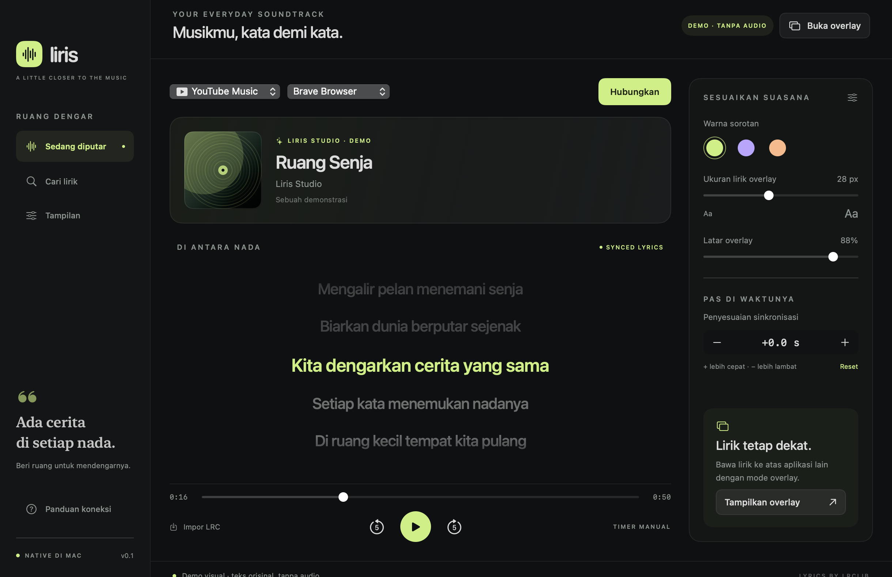

<p align="center">
  
</p>

<h1 align="center">Liris</h1>

<p align="center">Lirik yang mengikuti musikmu, langsung di desktop atau di overlay.</p>

<p align="center">
  <a href="#unduh">Unduh</a> ·
  <a href="#fitur">Fitur</a> ·
  <a href="#mulai-pakai">Mulai pakai</a> ·
  <a href="#dokumentasi">Dokumentasi</a>
</p>

## Unduh

| Platform | Unduhan langsung | Catatan rilis |
| --- | --- | --- |
| **macOS 14+ · Apple Silicon** | [Unduh Liris untuk Mac (.zip)](https://github.com/Fikriazrbni/Liris/releases/download/v0.4.3/Liris-v0.4.3-macos-arm64.zip) | [v0.4.3](https://github.com/Fikriazrbni/Liris/releases/tag/v0.4.3) |
| **Windows 11 · x64** | [Unduh installer Windows (.exe)](https://github.com/Fikriazrbni/Liris/releases/download/windows-v0.1.0/Liris-Setup-Windows-x64.exe) | [Preview v0.1.0](https://github.com/Fikriazrbni/Liris/releases/tag/windows-v0.1.0) |

Kedua paket siap dipakai dan sudah menyertakan runtime Python serta ShazamIO. Build Mac belum dinotariskan oleh Apple dan installer Windows belum ditandatangani.

**Homebrew (Mac)**

```sh
brew install --cask fikriazrbni/tap/liris
```

[Lihat semua rilis](https://github.com/Fikriazrbni/Liris/releases) · [Tap Homebrew](https://github.com/Fikriazrbni/homebrew-tap)

## Fitur

- **Lirik tersinkron** untuk YouTube dan YouTube Music lewat extension browser.
- **Pengenalan lagu dari audio sistem** untuk Discord dan aplikasi lain lewat ShazamIO. Posisi lirik dari pengenalan audio adalah perkiraan.
- **Overlay di atas jendela lain** dengan warna, ukuran, dan opasitas yang bisa diatur, serta mode klik tembus.
- **Lirik dari LRCLIB**, dengan pencarian manual, pilihan versi lirik, impor LRC, dan koreksi waktu per lagu. Lirik yang sudah tersimpan di cache bisa dibuka saat offline.

<p align="center">
  <br>
  <sub>Demo tampilan Liris di macOS</sub>
</p>

## Mulai pakai

1. **Instal.** Di Mac, ekstrak ZIP, pindahkan **Liris.app** ke **Applications**, lalu buka. Di Windows, jalankan installer dan cari **Liris** di menu Start.
2. **Hubungkan YouTube atau YouTube Music.** Di Mac, buka **Panduan koneksi → Buka extension dan Brave**. Di Windows, buka **Bantuan → Setup extension Windows** untuk Chrome, Brave, atau Edge. Di halaman extension browser, aktifkan **Developer mode**, pilih **Load unpacked**, lalu pilih folder yang dibuka Liris. Muat ulang tab musik dan klik **Hubungkan** di Liris. Pada Mac, pilih sumber **Auto**.
3. **Untuk Discord atau aplikasi lain**, klik **Aktifkan audio** secara manual setelah terhubung. Gunakan **Matikan audio** untuk berhenti.

Audio sistem selalu mati saat Liris dibuka, saat menghubungkan, dan saat menghubungkan ulang. Jika diaktifkan, cuplikan output sistem hanya disimpan di RAM dan signature dikirim ke Shazam. Liris tidak membuka mikrofon. Suara percakapan yang terdengar dari speaker atau headphone bisa ikut dianalisis. Pencarian lirik mengirim metadata lagu atau kata kunci ke [LRCLIB](https://lrclib.net/).

## Dokumentasi

- [Panduan macOS](docs/AUTO-SETUP.md) · [Panduan dan build Windows](windows/README.md)
- [Arsitektur](docs/ARCHITECTURE.md) · [Catatan pengujian macOS](docs/VALIDATION.md) · [Catatan pengujian Windows](windows/VALIDATION.md)

<details>
<summary>Build lokal di macOS</summary>

Gunakan macOS 14+ dengan Command Line Tools dan Swift 6 untuk menjalankan tes.

```sh
./scripts/setup-shazamio.sh
./scripts/build-app.sh
./scripts/run.sh
./scripts/test.sh
```

Aplikasi hasil build ada di `dist/Liris.app`. Untuk demo tanpa audio, jalankan `./scripts/run.sh --demo`.

</details>

Terinspirasi oleh [FrontLine Lyrics Desktop](https://github.com/juliocax/FrontLine-Lyrics-Desktop).
