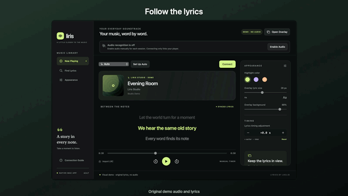
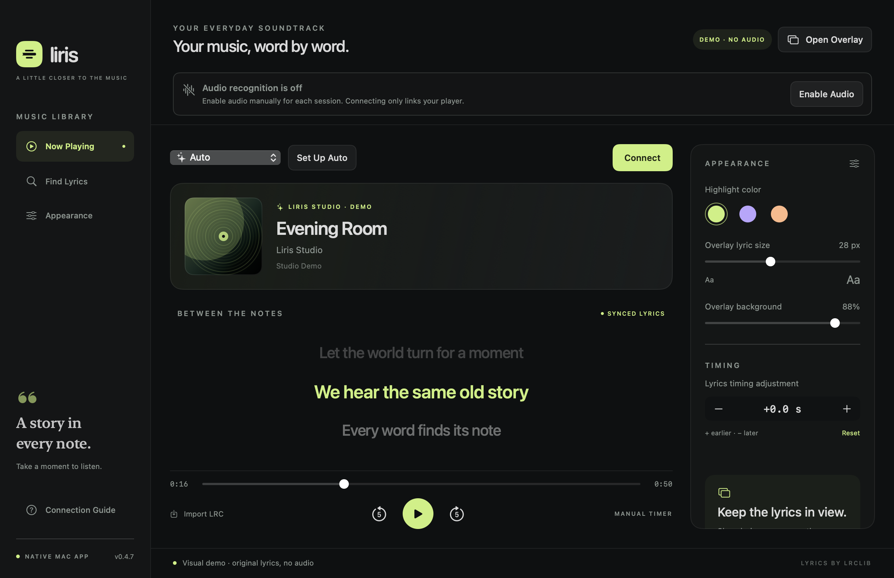
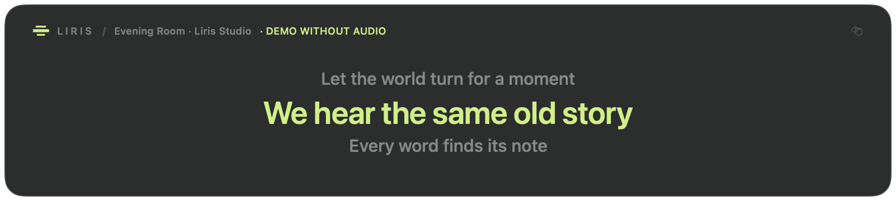

<p align="center">
  
</p>

<h1 align="center">Liris</h1>

<p align="center">Follow the lyrics on Mac or Windows, in the app or in a floating overlay that stays visible when you switch windows.</p>

<p align="center">
  <a href="#downloads">Downloads</a> ·
  <a href="#getting-started">Getting started</a> ·
  <a href="#features">Features</a> ·
  <a href="#screenshots">Screenshots</a> ·
  <a href="#documentation">Documentation</a>
</p>

<p align="center">
  
</p>

## Downloads

| Platform | Download | Release notes |
| --- | --- | --- |
| macOS 14+ · Apple Silicon | [Mac ZIP](https://github.com/Fikriazrbni/Liris/releases/download/v0.4.8/Liris-v0.4.8-macos-arm64.zip) | [v0.4.8](https://github.com/Fikriazrbni/Liris/releases/tag/v0.4.8) |
| Windows 11 · x64 | [Windows installer](https://github.com/Fikriazrbni/Liris/releases/download/windows-v0.1.1/Liris-Setup-Windows-x64.exe) | [Preview v0.1.1](https://github.com/Fikriazrbni/Liris/releases/tag/windows-v0.1.1) |

Both packages include Python and ShazamIO. The Mac build is ad hoc signed and has not been notarized by Apple. The Windows installer is unsigned.

### Homebrew on Mac

```sh
brew install --cask fikriazrbni/tap/liris
```

To upgrade an existing installation, quit Liris and run the following commands. [Homebrew tap](https://github.com/Fikriazrbni/homebrew-tap)

```sh
brew update
brew upgrade --cask fikriazrbni/tap/liris
```

## Getting started

**On Mac**, extract the ZIP, move **Liris.app** to **Applications**, and open it. From v0.4.7 onward, Liris starts in the menu bar with its main window closed. Click the three-line icon near the clock and choose **Open Liris**. The same action restores a minimized window. While audio recognition is active, a recording indicator takes the icon’s place.

Liris stays out of the Dock and the app switcher (⌘ Tab). Closing its window keeps the player connection and overlay running. Choose **Quit** from the menu bar to stop the app.

**On Windows**, run the installer and open **Liris** from the Start menu.

### YouTube and YouTube Music

1. On Mac, open **Connection Guide → Open Extension and Brave**. On Windows, choose **Help → Set Up Extension**. Liris opens the extension folder for you.
2. On your browser’s Extensions page, enable **Developer mode**, click **Load unpacked**, and select that folder.
3. Reload the music tab. On Mac, Liris tries to reconnect to the last player when it starts. Choose **Auto** to use the extension. If disconnected, click **Connect** in the main window or menu bar. On Windows, click **Connect** in the app.

### Discord and other apps

Connect to the player, then click **Enable Audio** to identify music playing through your system output. Click **Stop Audio** when you’re done. With audio recognition, lyric timing is an estimate.

## Features

- **Synced lyrics** follow the playback position reported by YouTube or YouTube Music through the browser extension.
- **Floating overlay** shows the song title and the previous, current, and next lines. Adjust the highlight color, text size, and opacity. On Mac, the header also shows the artist when available. Click the padlock to lock or unlock the overlay.
- **Lyrics search** finds songs on LRCLIB. Pick a different version or import a timed LRC file. Cached lyrics are available offline.

## Screenshots

Both screenshots show the Mac app in demo mode using original lyrics.

<p align="center">
  <br>
  <sub>Main window</sub>
</p>

<p align="center">
  <br>
  <sub>Three-line overlay</sub>
</p>

## Privacy

Audio recognition is off when Liris starts or reconnects. If you enable it, Liris reads system output without opening the microphone. Audio samples stay in memory, and Liris sends fingerprints to Shazam. Conversations audible through your speakers or headphones can be included. Lyrics searches send track metadata or your search terms to LRCLIB.

## Documentation

- [Mac setup guide](docs/AUTO-SETUP.md) · [Windows setup and build guide](windows/README.md)
- [Architecture](docs/ARCHITECTURE.md) · [Mac test notes](docs/VALIDATION.md) · [Windows test notes](windows/VALIDATION.md)
- [All releases](https://github.com/Fikriazrbni/Liris/releases)

<details>
<summary>Build locally on Mac</summary>

Use macOS 14 or later, the Xcode Command Line Tools, and uv. The tests require Swift 6.

```sh
./scripts/setup-shazamio.sh
./scripts/build-app.sh
./scripts/run.sh
./scripts/test.sh
```

The build produces `dist/Liris.app`. Run `./scripts/run.sh --demo` to try the app with sample lyrics and no audio.

</details>

Inspired by [FrontLine Lyrics Desktop](https://github.com/juliocax/FrontLine-Lyrics-Desktop).
