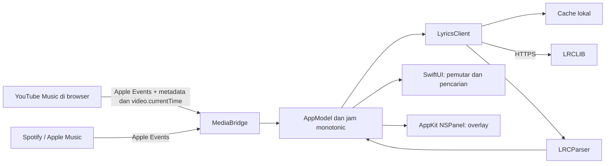

# Rancangan Liris

## Alur data

## Komponen

| Komponen | Tanggung jawab |
| --- | --- |
| `LirisCore/Lyrics.swift` | Model lirik, parser LRC, lookup baris dengan binary search, matching konservatif |
| `LirisCore/LyricsClient.swift` | URLSession dalam actor, validasi HTTP/MIME, cooldown, cache memori/disk |
| `LirisCore/PlaybackClock.swift` | Interpolasi monotonic, snapshot integer, pause/seek, playback rate, batas saat pemutar macet |
| `LirisCore/PlayerTimeMonitor.swift` | Validasi dan pemantauan temporal beberapa sumber waktu, stall, pemulihan, hysteresis |
| `LirisCore/SyncAssessment.swift` | Signature lagu, penilaian metadata/versi, perbandingan timing, status ketidakpastian |
| `LirisApp/MediaBridge.swift` | Skrip tetap untuk browser/aplikasi, subprocess tanpa shell, timeout/cancellation |
| `LirisApp/Resources/youtube-music.js` | Snapshot DOM dan mediaSession; tidak mengunggah audio |
| `LirisApp/AppModel.swift` | State UI, polling serial, pembatalan task, generasi request, acuan waktu pemutaran |
| `LirisApp/ContentView.swift` | Ruang dengar, kartu lagu, scroll lirik, kontrol playback |
| `LirisApp/DetailViews.swift` | Pencarian, pengaturan tampilan, sinkronisasi, panduan izin |
| `LirisApp/OverlayController.swift` | NSPanel floating di Spaces/fullscreen, posisi persisten, klik menembus |

## Sinkronisasi

Posisi pemutar diambil setiap sekitar satu detik; UI diperbarui 10 kali per detik berdasarkan selisih `systemUptime`. Snapshot pause menghentikan interpolasi, sedangkan snapshot seek mengganti posisi acuannya. Tidak ada penambahan durasi secara kumulatif berdasarkan jumlah tick. Timestamp aktif adalah baris terakhir dengan `time <= position + adjustment`. Adjustment positif memajukan lirik. Baris kosong tetap dipertahankan agar jeda instrumental tidak menampilkan bait sebelumnya terus-menerus.

Mulai 0.1.2, posisi video dibandingkan dengan progress bar YouTube Music. Selisih di atas 1,25 detik memicu fallback ke angka progress bar; jam media dengan presisi subdetik tetap dipakai bila keduanya cocok. MediaSession menjadi acuan status play/pause. Fallback progress bar memakai jeda polling 250 ms setelah setiap permintaan selesai, dengan overhead Apple Events di luar jeda itu. Snapshot integer yang belum berubah tidak mengatur ulang anchor; interpolasi dibatasi satu detik di depan angka terakhir agar buffering atau progress bar macet tidak membuat lirik terus maju. Pergantian sumber waktu, pause/resume, seek, atau playback rate mengatur ulang anchor.

Pergantian sumber atau lagu membatalkan pencarian lama. Token generasi mencegah hasil jaringan lama mengganti lirik lagu baru. Pilihan lirik manual dan impor membatalkan pencarian otomatis yang masih berjalan, lalu mengikuti posisi pemutar yang sama. Setelah lagu berubah, lirik kembali dicari untuk lagu baru. Error izin menghentikan polling sampai pengguna menghubungkan ulang.

## Pemeriksaan otomatis 0.2.0

PlayerTimeMonitor menyimpan perkembangan angka media/progress/clock lintas sampel. Media yang tidak bergerak selama lebih dari 2,5 detik saat status playing dianggap macet; progress yang tidak berubah lebih dari tiga detik dapat digantikan media yang masih bergerak. Posisi negatif, non-finite, atau di luar durasi ditolak. Konflik UI tanpa acuan yang sejalan menahan lirik; kemajuan sumber memulihkannya otomatis. Media harus cocok dengan UI selama tiga sampel sebelum diambil kembali setelah fallback.

LyricsClient.resolve menggabungkan hasil exact, kandidat pencarian, dan pilihan lokal. SyncAssessment menolak metadata atau versi yang bertentangan, durasi berbeda lebih dari lima detik, isi kosong/rusak, dan timestamp melewati akhir lagu. Kandidat plausible diranking berdasarkan lirik bertimestamp, kecocokan album, dan kedekatan durasi. Empat atau lebih baris unik yang sama dengan median perbedaan waktu lebih dari dua detik menandakan konflik timing. Konflik menghasilkan status uncertain, tidak memicu retiming atau klaim akurasi vokal. ID/kopi lirik bukan suara independen untuk voting.

Arsip pemeriksaan versi memiliki format terpisah `assessment-v1`, TTL tujuh hari, validasi ulang metadata setiap dibaca, dan batas kandidat 32. Pilihan lokal `choice` dipertahankan hanya jika lolos pemeriksaan struktural. Hasil pencarian dalam actor memiliki memo sepuluh menit agar fallback exact dan perbandingan tidak menggandakan permintaan. Force refresh melewati arsip/hasil pencarian memo, dan hasil baru untuk ID sama mengungguli data lama. Jika internet gagal, kandidat lokal yang cocok tetap disajikan dengan ketidakpastian yang jelas.

Pilihan versi dan offset diikat ke signature judul/artis/album/durasi, bukan URL tab yang berubah. Pengguna dapat menghapus pilihan otomatis; impor/pilihan eksplisit yang tidak cocok tetap terlihat dengan peringatan dan tidak dipromosikan menjadi preferensi aman. Tidak ada analisis vokal atau pengiriman koreksi pengguna ke server.

## Pilihan platform

Target macOS 14+, Swift Package Manager, tanpa dependensi pihak ketiga. AppKit dipakai untuk perilaku overlay yang spesifik desktop; SwiftUI untuk antarmuka. Tidak memakai API privat MediaRemote. Untuk YouTube Music, integrasi browser dipilih agar tidak perlu login Google di embedded webview dan musik tetap berada di browser pengguna. Konsekuensinya, pengguna harus mengaktifkan izin JavaScript Apple Events satu kali.

Pengenalan audio dengan ShazamKit memerlukan konfigurasi App ID/service di Apple Developer serta akses audio sistem. Fitur itu tidak dimasukkan ke versi lokal ini. [Dokumentasi ShazamKit Apple](https://developer.apple.com/help/account/services/shazamkit).

Build lokal ditandatangani ad hoc dengan entitlement Automation. Distribusi Developer ID, notarization, updater, serta pengujian lintas versi macOS perlu dilakukan sebelum rilis publik.
