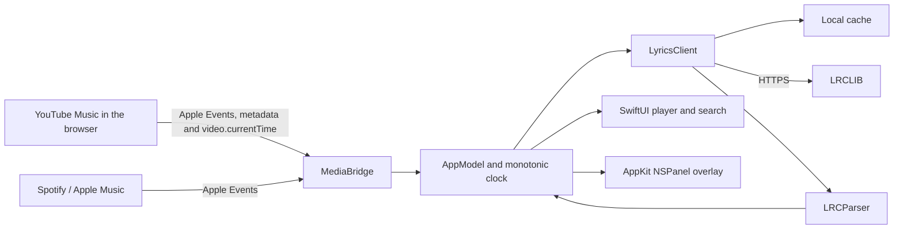

# Liris architecture

## Player data flow

## Components

| Component | Responsibility |
| --- | --- |
| `LirisCore/Lyrics.swift` | Lyric model, LRC parsing, binary search for the active line, conservative track matching |
| `LirisCore/LyricsClient.swift` | URLSession requests within an actor, HTTP and MIME validation, cooldown, memory and disk caches |
| `LirisCore/PlaybackClock.swift` | Monotonic interpolation, whole-second snapshots, pause and seek handling, playback rate, limits when the player stalls |
| `LirisCore/PlayerTimeMonitor.swift` | Validation of multiple time sources across samples, stall detection, recovery, and hysteresis |
| `LirisCore/SyncAssessment.swift` | Track signature, metadata and version checks, candidate timing comparison, uncertainty reporting |
| `LirisApp/MediaBridge.swift` | Fixed scripts for browsers and desktop players, subprocesses launched without a shell, timeouts and cancellation |
| `LirisApp/Resources/youtube-music.js` | DOM and MediaSession snapshots without audio upload |
| `LirisApp/AppModel.swift` | UI state, serial polling, task cancellation, request generations, playback time reference |
| `LirisApp/ContentView.swift` | Now Playing, track card, scrolling lyrics, playback controls |
| `LirisApp/DetailViews.swift` | Search, appearance settings, sync controls, permissions guide |
| `LirisApp/OverlayController.swift` | Floating NSPanel across Spaces and full-screen apps, saved window position, click-through mode |

## Synchronization

Liris reads the player position about once a second. The UI updates ten times a second using elapsed `systemUptime`. A paused snapshot stops interpolation. A seek replaces the reference position. The clock derives elapsed time from the reference instead of accumulating a duration per tick. The active line is the last one with `time <= position + adjustment`. A positive adjustment displays lyrics earlier. Empty lines clear the previous lyric during instrumental breaks.

Since 0.1.2, Liris compares the video position with the YouTube Music progress bar. A difference over 1.25 seconds triggers a fallback to the progress bar. When the two agree, the higher-resolution media time takes precedence. MediaSession supplies the play/pause state. When using the progress bar, the app waits 250 ms after each completed poll. Apple Events add their own latency. Repeated whole-second readings leave the reference position in place. Interpolation stops one second beyond the last reading so that lyrics do not keep advancing during buffering or a stall. Switching time sources, pausing, resuming, seeking, or changing playback rate resets the reference.

Switching source or track cancels an outstanding lyric search. A generation token prevents an old network response from replacing the new track's lyrics. Selecting or importing lyrics also cancels an automatic search and keeps the selection on the current player timeline. The next track triggers a new search. Permission errors stop polling until the user reconnects.

## Automatic checks in 0.2.0

`PlayerTimeMonitor` tracks changes across media time, the progress bar and the visible clock. Media time is considered stalled if it stays still for more than 2.5 seconds while playback is active. If the progress bar is stationary for more than three seconds, advancing media time can take over. The monitor rejects negative, non-finite and out-of-range positions. When the UI clocks conflict and no other reference agrees, lyrics pause. They resume when a source recovers. After a fallback, media time must agree with the UI for three samples before it takes over again.

`LyricsClient.resolve` combines exact results, search candidates and saved choices. `SyncAssessment` rejects conflicting metadata or versions, duration differences over five seconds, empty or malformed content, and timestamps beyond the end of the track. It ranks plausible candidates by timestamp availability, album match and duration. Four or more matching unique lines with a median timing difference over two seconds indicate a conflict. The result is marked uncertain. The app does not retime lyrics automatically or treat this comparison as a measurement of vocal accuracy. Duplicate lyrics or record IDs do not count as independent votes.

Version assessments use a separate `assessment-v1` archive, expire after seven days, and hold up to 32 candidates. The app rechecks the metadata on every read. It retains a saved `choice` only when it passes structural checks. The actor keeps search results in memory for ten minutes so exact-match fallback and version comparison can reuse a request. A forced refresh bypasses both caches, and a fresh result supersedes an older one with the same ID. If the network fails, Liris can show a suitable local candidate and identify the uncertainty.

Version choices and offsets use the track's title, artist, album and duration as their key, independent of changes to the tab URL. Users can clear a saved choice to restore automatic selection. An explicit selection or imported file with conflicting metadata remains visible with a warning and is excluded from automatic preferences. Liris neither analyzes vocals for this comparison nor sends user timing corrections to a server.

## Platform choices

The original native player integration targets macOS 14+ and uses Swift Package Manager without third-party Swift dependencies. AppKit supplies desktop overlay behavior and SwiftUI supplies the interface. The integration uses public APIs and avoids the private MediaRemote API. YouTube Music runs in the user's browser, which avoids a separate Google sign-in inside an embedded web view. The direct Apple Events integration requires one-time permission to run JavaScript in that browser. The extension-based Auto source is documented in the [Auto setup guide](AUTO-SETUP.md).

ShazamKit requires an Apple Developer App ID and service configuration as well as system audio access. The original local build omitted that integration. Later releases use ShazamIO for audio recognition. [Apple's ShazamKit documentation](https://developer.apple.com/help/account/services/shazamkit)

Local builds use ad hoc signing with the Automation entitlement. The original distribution plan called for Developer ID signing, notarization, an updater, and testing across macOS versions before a public release.
